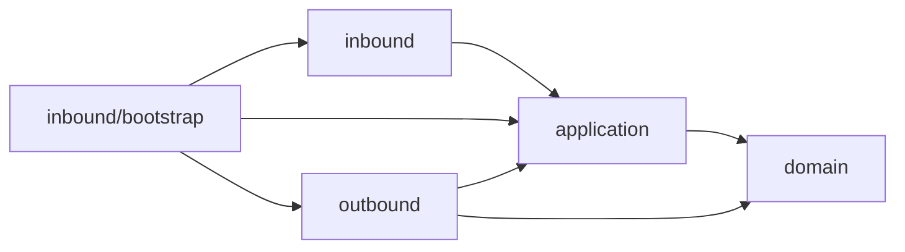

# architecture-skills

小さく始める設計と、既存の動作を保つ移行・AI開発のためのAgent Skills。日本語で記述し、必要な詳細だけを参照する構成です。

| スキル | 用途 |
| --- | --- |
| [ddd-bestpractice](skills/ddd-bestpractice/SKILL.md) | 最小DDD、4ディレクトリ、依存方向、構成レビュー、アンチパターン、段階的移行 |
| [monorepo-migration](skills/monorepo-migration/SKILL.md) | workspace、Git履歴、Issue・PR、npm→pnpm、CI、デプロイ、ロールバック |
| [ai-driven-development](skills/ai-driven-development/SKILL.md) | AI開発フロー、決定論的な処理境界、Gemini 3.1等のモデル選定と評価 |

3つは単独で利用できます。monorepo化にDDDを要求せず、DDDは単一アプリでも使えます。

## インストール

必要なスキルを指定してインストールできます。

```sh
npx skills add takashiAg/architecture-skills --skill ddd-bestpractice
npx skills add takashiAg/architecture-skills --skill monorepo-migration
npx skills add takashiAg/architecture-skills --skill ai-driven-development
```

リポジトリをローカルにcloneした場合の確認（親ディレクトリから実行）:

```sh
npx skills add ./architecture-skills --list
```

ローカルから導入する場合は `--list` を外し、必要な `--skill` を指定します。`npx skills` の利用方法は[公式README](https://github.com/vercel-labs/skills)を参照してください。npmへのpackage公開は不要です。

## 使い方の例

- `ddd-bestpracticeを使って既存のsrc構成と依存方向をレビューして。monorepoだけど、不要なpackage分割は増やさないで。`
- `monorepo-migrationを使って2つのrepoを統合したい。元SHAを保ち、open Issueの移行とnpmからpnpmへの統一も計画して。`
- `ai-driven-developmentを使ってAIの利用箇所をレビューして。金額計算や権限判定をLLM任せにしていないか確認して。`
- `Gemini 3.1 Proを採用すべきか、現在の公式情報と実タスクの評価基準から比較案を作って。`

## DDDの基本構成

```text
src/
├── domain/        # 業務ルール
├── application/   # ユースケースとポート
├── outbound/      # DB・外部APIの実装
└── inbound/       # HTTP・CLI・ジョブ等の入口
    └── bootstrap/ # 配線と起動
```



矢印はimport依存です。実行時はapplicationが注入されたポートを呼び、outboundが動きます。bootstrapのみ配線のためにoutboundを参照します。この配置は本スキルの規約であり、DDD一般の唯一の正解ではありません。

## AIに任せる境界

曖昧な入力の解釈や提案にはAIを使い、計算・権限・状態遷移・冪等性・CI合否はコードで保証します。JSON出力や低temperatureだけを正しさの根拠にしません。モデル名は固定推奨せず、正確なID・提供状態・費用を公式資料で再確認し、実タスクで評価します。

## 公開・メンテナンス

`skills/<name>/SKILL.md` を入口にし、詳細は各 `references/`、表示情報は `agents/openai.yaml` に置いています。各スキルに一次資料と確認日を記録しています。ツールの設定・モデル情報は採用時にも再確認します。

現時点ではライセンスは未設定です。
