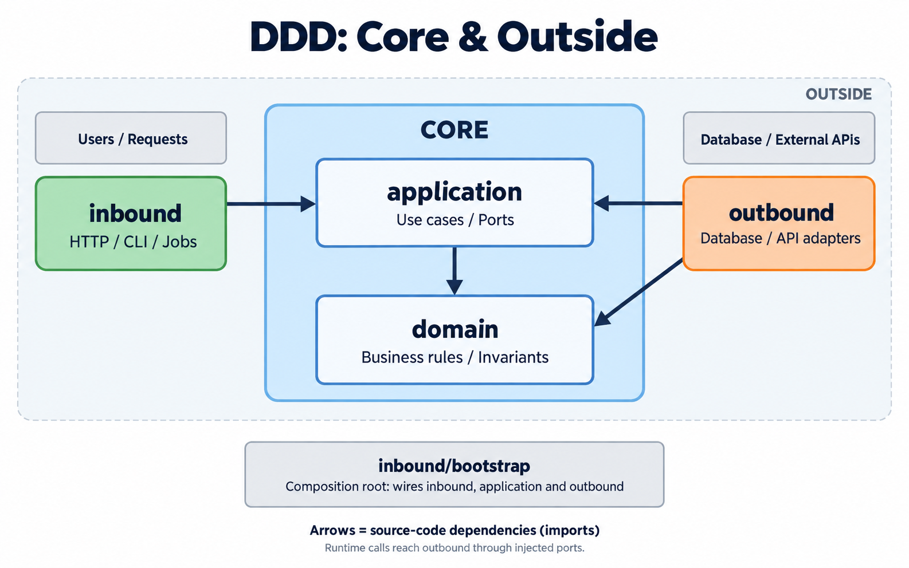

# architecture-skills

小さく始める設計、既存の動作を保つ移行・AI開発、職能エージェントが協働するプロダクト開発のためのAgent Skills。日本語で記述し、必要な詳細だけを参照する構成です。

| スキル | 用途 |
| --- | --- |
| [ddd-bestpractice](skills/ddd-bestpractice/SKILL.md) | 最小DDD、4ディレクトリ、依存方向、構成レビュー、アンチパターン、段階的移行 |
| [monorepo-migration](skills/monorepo-migration/SKILL.md) | workspace、Git履歴、Issue・PR、npm→pnpm、実行基盤・scripts整理、CI、デプロイ、ロールバック |
| [ai-driven-development](skills/ai-driven-development/SKILL.md) | AI開発フロー、決定論的な処理境界、Gemini 3.1等のモデル選定と評価 |
| [product-team](skills/product-team/SKILL.md) | マネージャーと22職能のサブエージェント。営業・CS・Ops・UX/UI・開発・QA・文書化を協働、個別呼び出しも可能 |

4つは単独で利用できます。monorepo化にDDDを要求せず、DDDは単一アプリでも使えます。product-teamも他のスキルの導入を必須としません。

スキル本体は共通の `SKILL.md` 形式です。Claude Code、Cursor、Gemini CLI、OpenCodeなど、Agent Skillsに対応するエージェントへ導入できます。

## インストール

必要なスキルを指定してインストールできます。

```sh
npx skills add takashiAg/architecture-skills --skill ddd-bestpractice
npx skills add takashiAg/architecture-skills --skill monorepo-migration
npx skills add takashiAg/architecture-skills --skill ai-driven-development
npx skills add takashiAg/architecture-skills --skill product-team --agent codex claude-code
```

### エージェントを指定する

利用するプロジェクトのディレクトリで実行します。次は全スキルをまとめて導入する例です。`'*'` はシェルで展開されないよう引用符を付けます。

```sh
# Claude Code
npx skills add takashiAg/architecture-skills --agent claude-code --skill '*'

# Cursor
npx skills add takashiAg/architecture-skills --agent cursor --skill '*'

# Gemini CLI
npx skills add takashiAg/architecture-skills --agent gemini-cli --skill '*'

# OpenCode
npx skills add takashiAg/architecture-skills --agent opencode --skill '*'
```

一つだけなら `--skill '*'` を `--skill ddd-bestpractice` などに変えます。複数のエージェントへ導入する場合:

```sh
npx skills add takashiAg/architecture-skills --agent claude-code cursor --skill '*'
```

既定はプロジェクト単位です。個人の全プロジェクトで使いたい場合は `--global` を付けます。

```sh
npx skills add takashiAg/architecture-skills --agent claude-code --skill '*' --global
```

対象エージェントと配置は [`skills` CLIの対応一覧](https://github.com/vercel-labs/skills#supported-agents)を参照してください。対応機能やスキルの呼び出し方はエージェントとバージョンによって異なります。

### Claude Codeで使う

導入後、Claude Codeで以下のように呼び出せます。

```text
/ddd-bestpractice 現在のsrc構成と依存方向をレビューして
/monorepo-migration Git履歴を保ち、npmからpnpmへの統一も含めて移行案を作って
/ai-driven-development 決定論的に保証すべき処理をLLM任せにしていないか確認して
```

説明に合う依頼から自動選択されることもあります。詳細は[Claude Code公式のSkillsガイド](https://code.claude.com/docs/en/skills)を参照してください。他のエージェントでは、それぞれのスキル選択機能や、下記の自然言語による依頼例を使います。

### 手動配置

Claude Codeでは、必要な `skills/<name>/` をディレクトリごとプロジェクトの `.claude/skills/<name>/` へコピーしても利用できます。個人用は `~/.claude/skills/<name>/` です。`SKILL.md` だけでなく `references/` も一緒に配置してください。

```text
.claude/skills/ddd-bestpractice/
├── SKILL.md
├── references/
└── agents/        # 任意の表示メタデータ
```

`agents/openai.yaml` はCodex向けの任意の表示情報です。共通の手順はすべて `SKILL.md` と `references/` にあり、このファイルを使わないエージェントでも読めます。専用MCPサーバーや特定ベンダーのAPIキーはスキル自体の必須条件ではありません。実際のGitHub操作やモデル評価には、その作業に必要なツール・認証を使います。

### 確認済みの範囲

2026-09-28に、`skills` CLIでClaude Code・Cursor・Gemini CLI・OpenCodeを指定した一時ディレクトリへの導入を確認しました。3スキルの本体と全参照ファイルが配置されることを検証済みです。各エージェントを起動した動作評価は未実施です。

2026-10-12に、product-teamを`skills` CLI 1.7.2でCodex・Claude Code向けの一時ディレクトリへ導入し、全29ファイルが元と一致することを確認しました。形式・参照リンクの検証、個別依頼・QA実行不能・孫非対応の3シナリオの独立レビューを実施しています。今回のCodex環境では子から孫を起動しレビュー結果を受け取る動作も確認しました。Claude Codeでの組織全体の実行、実プロダクトでの開発・Playwright打鍵は未検証です。

### ローカル確認

リポジトリをローカルにcloneした場合の確認（親ディレクトリから実行）:

```sh
npx skills add ./architecture-skills --list
```

ローカルから導入する場合は `--list` を外し、必要な `--skill` を指定します。`npx skills` の利用方法は[公式README](https://github.com/vercel-labs/skills)を参照してください。npmへのpackage公開は不要です。

## 使い方の例

- `ddd-bestpracticeを使って既存のsrc構成と依存方向をレビューして。monorepoだけど、不要なpackage分割は増やさないで。`
- `monorepo-migrationを使って2つのrepoを統合したい。元SHAを保ち、open Issueの移行とnpmからpnpmへの統一も計画して。`
- `ai-driven-developmentを使ってAIの利用箇所をレビューして。金額計算や権限判定をLLM任せにしていないか確認して。`
- `Gemini 3.1 Proを採用すべきか、現在の公式情報と実タスクの評価基準から比較案を作って。`

## Product Team: マネージャーと職能エージェント

ユーザーと対話するCodex／Claude Codeの下にマネージャー、その下に必要な担当を置きます。エンジニアも、ドキュメント担当もマネージャー直下です。担当の詳しい責任は[職能一覧](skills/product-team/references/catalog.md)を参照してください。

```text
ユーザー ↔ Codex / Claude Code
             └─ マネージャー
                 ├─ BizOps / SalesOps / CS Ops
                 ├─ IS / FS / プレセールス / CS / マーケ
                 ├─ PdM / UXデザイナー / UIデザイナー
                 ├─ 設計 / フロントエンド / バックエンド / インフラ
                 ├─ QA設計 / QA実行（打鍵）/ セキュリティ / データ分析
                 └─ テクニカルライター / 事業責任者 / 経営者レビュー
```

必要な担当だけを起動し、担当間の質問・返答・変更をマネージャーまたはホストが取り次ぎます。QA設計はケースを作り、QA実行は利用可能なPlaywrightやブラウザツールで各ステップを確認します。ライターは実装内容と実測結果から仕様・操作手順・FAQ・リリースノートをまとめます。

Codexでの例:

```text
$product-team マネージャーにオンボーディング改善を任せ、実装と検証まで進めて。
$product-team FSだけ呼んで、この案件の提案と次のアクションを作って。
$product-team SalesOpsとCS Opsで、受注後の引き継ぎを整えて。
$product-team UXとUIとフロントエンドで画面を改善し、QA設計とQA実行で確認して。
$product-team テクニカルライターだけ呼んで、実装とQA結果から操作手順をまとめて。
```

Claude Codeでは先頭を `/product-team` に置き換えます。一職能だけの呼び出しではマネージャーを挟まず、その担当を直接起動します。

`product-team` 一式に役割定義を同梱し、実行時に汎用サブエージェントへ渡します。`npx skills add` だけで導入でき、別途カスタムエージェント設定を書き換える必要はありません。ネイティブの `/agents` 一覧へ23人を登録するパッケージではありません。

孫を起動できない環境ではホストが担当の起動を代行します。並列数は環境に合わせ、全職種を一斉に呼びません。詳細と確認した公式資料は[実行環境への対応](skills/product-team/references/runtime.md)を参照してください。

ローカルの変更を導入する場合は、利用先プロジェクトでリポジトリのパスを指定します:

```sh
npx skills add /path/to/architecture-skills --skill product-team --agent codex claude-code
```

GitHub形式のインストールコマンドは、その参照先ブランチにproduct-teamが存在する状態で利用できます。

## DDDの基本構成

```text
src/
├── domain/        # 業務ルール
├── application/   # ユースケースとポート
├── outbound/      # DB・外部APIの実装
└── inbound/       # HTTP・CLI・ジョブ等の入口
    └── bootstrap/ # 配線と起動
```



中央の青い領域が **Core（application・domain）**、その外側が入口・外部接続を担う **inbound・outbound** です。CoreはHTTPやDBなどの具体的な技術に依存しません。

矢印はimport依存です。実行時はapplicationが注入されたポートを呼び、outboundが動きます。bootstrapのみ配線のためにoutboundを参照します。この配置は本スキルの規約であり、DDD一般の唯一の正解ではありません。

## srcとscripts・実行コマンド

業務処理を起動するCLIやバッチは `src/inbound/cli`・`src/inbound/jobs`、配線は `src/inbound/bootstrap` に置きます。業務判断はdomain、処理順序はapplicationへ委譲します。ビルド、コード生成、開発環境の準備はrepo／package直下の `scripts/` に分けます。

Node系では `pnpm run <task>` を開発者・CI・AIの共通入口にし、必要なshはその実装として呼び出します。同じタスクの別実装をshとpackage.jsonに重複させません。引数、作業ディレクトリ、環境変数、exit codeまで揃えます。

詳細はDDDの[配置指針](skills/ddd-bestpractice/references/architecture.md)とmonorepo移行の[実行基盤ガイド](skills/monorepo-migration/references/execution.md)を参照してください。

## AIに任せる境界

曖昧な入力の解釈や提案にはAIを使い、計算・権限・状態遷移・冪等性・CI合否はコードで保証します。JSON出力や低temperatureだけを正しさの根拠にしません。モデル名は固定推奨せず、正確なID・提供状態・費用を公式資料で再確認し、実タスクで評価します。

## 公開・メンテナンス

`skills/<name>/SKILL.md` を入口にし、詳細は各 `references/`、Codex向けの任意の表示情報は `agents/openai.yaml` に置いています。各スキルに一次資料と確認日を記録しています。ツールの設定・モデル情報は採用時にも再確認します。

現時点ではライセンスは未設定です。
